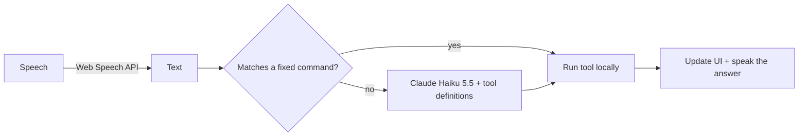
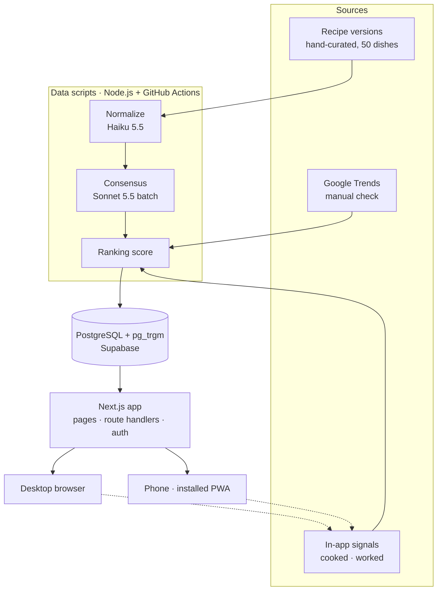

<div align="center">

# Sofrana

**One recipe per dish, backed by data — with a voice-controlled kitchen mode.**

Sofrana compares dozens of versions of the same dish, extracts the "consensus recipe" that most cooks agree on, and shows you *why* every ingredient is there. It runs in the browser and installs on your phone like an app.

<sub>The name comes from *sofra*, the Turkish word for the table where a meal is shared.</sub>

[Roadmap](docs/ROADMAP.md) · [Türkçe](README.tr.md) · Live demo and video: coming soon


</div>

> **Status:** in active development (week 1 of 12). A non-commercial portfolio project built by two junior full stack developers.

<!-- Replace with a real screenshot or GIF once the recipe page exists -->
<!--  -->

---

## Why Sofrana?

Search for *karnıyarık* and you get hundreds of different recipes. Which one actually works? Recipe pages are full of ads and long stories, and scrolling with oily hands in the kitchen is painful.

Sofrana solves this with three ideas:

1. **One consensus recipe per dish**, built from 10–15 public versions of the same dish.
2. **Transparency:** the *"Why this way?"* panel shows how many versions use each ingredient.
3. **Hands-free cooking:** a kitchen mode you control with your voice, on any phone.

## Features

| | Feature | What it shows | Owner |
| --- | --- | --- | --- |
| 1 | **Consensus recipe + "Why this way?" panel** | Data pipeline, LLM-assisted normalization, animated data visualization | A |
| 2 | **Smart servings + menu builder** | Unit conversion, non-linear scaling rules, a cooking-order scheduler | B |
| 3 | **Voice kitchen mode** | Speech recognition, rule-based command parsing, Claude tool use | B |
| 4 | **"What's in my fridge?" search** | Postgres full-text + trigram search, typo tolerance | A |
| 5 | **Regional cuisine map** | Interactive SVG map of 15 provinces, regional recipe variants | A |
| 6 | **Installable on your phone (PWA)** | Add to home screen, screen stays awake while cooking, recent recipes offline | B |

Each of us owns three features end to end, from the database to the screen. Every feature has a measurable definition of done in the [roadmap](docs/ROADMAP.md#definition-of-done).

## How the consensus recipe works

```text
10–15 versions of a dish
        │  (ingredient lists only, entered by hand with their source)
        ▼
Normalize   "1 su bardağı un" → 120 g, merge synonyms        (Claude Haiku 5.5, batch)
        ▼
Count       used in ≥ 60 % of versions → core
            25–60 %                    → optional variation
            < 25 %                     → dropped
        ▼
Quantity    median amount per ingredient, scaled to 4 servings
        ▼
Write       steps rewritten in our own words, TR + EN         (Claude Sonnet 5.5, batch)
        ▼
Verify      we cook it ourselves → "tested" badge
```

Recipes are ranked with a simple, explainable score:

```text
score    = 0.5 · P_bayes + 0.3 · prevalence + 0.2 · in_app_feedback
P_bayes  = v / (v + m) · R + m / (v + m) · C
```

`R` is a version's average rating, `v` its vote count, `C` the global average and `m` a confidence threshold (20 votes), so a 5-star recipe with two votes cannot dominate.

## Voice kitchen mode: rules first, Claude when needed

Fixed commands never hit an LLM. Only free-form questions do. This keeps the assistant fast and almost free.



| Tool | Example | Layer |
| --- | --- | --- |
| `open_recipe` | "Karnıyarık tarifini aç" | Rules |
| `set_servings` | "6 kişilik yap" | Rules |
| `next_step` / `repeat_step` | "Sonraki adım", "tekrar et" | Rules |
| `set_timer` | "On dakika kur" | Rules |
| `search_recipe` | "Yarım saatte biten vejetaryen bir şey" | Claude |
| `ask_substitute` | "Tereyağı yerine ne koyabilirim?" | Claude |

Accuracy is measured on a 20-command test set recorded with three voices and kitchen background noise. Results: _coming in week 8_.

Speech recognition works in Chrome and Safari but not Firefox; where it is missing, the mic button is hidden and a typed command box is always available.

## Architecture



Heavy work (normalization, consensus, scoring) runs once in the data pipeline and is stored in the database. The app only reads precomputed results, so pages are fast and AI cost does not grow with traffic.

**Why a PWA instead of a separate mobile app?** One codebase instead of two. The kitchen mode needs a phone, voice and a screen that stays on — all available in the browser today (Web Speech API, Screen Wake Lock API, service workers). Business logic lives in `src/lib/core` as pure functions, so a native app could reuse it later.

## Tech stack

| Layer | Technology |
| --- | --- |
| App | Next.js 16 (App Router), TypeScript, pnpm |
| UI | Tailwind CSS, shadcn/ui, Motion |
| PWA | Next.js manifest, Serwist (service worker), Screen Wake Lock API |
| Database | PostgreSQL on Supabase, Drizzle ORM, pg_trgm |
| Auth | Supabase Auth |
| AI | Claude API (Haiku 5.5, Sonnet 5.5) |
| Voice | Web Speech API (recognition and synthesis) |
| i18n | next-intl (Turkish and English) |
| Testing | Vitest, Playwright |
| CI / hosting | GitHub Actions, Vercel (Hobby) |

## Project structure

```text
sofrana/
├── src/
│   ├── app/                  # Routes: pages, API route handlers, admin form
│   ├── components/           # UI components and design system
│   └── lib/
│       ├── core/             # Pure business logic: scaling, menu, voice parser (fully tested)
│       ├── db/               # Drizzle schema and queries
│       └── ai/               # Claude client and tool definitions (server only)
├── scripts/
│   └── pipeline/             # normalize → consensus → score
├── data/
│   └── versions/             # Hand-curated ingredient lists (CSV) with source URLs
├── tests/e2e/                # Playwright tests
├── public/                   # Icons, manifest assets
└── docs/                     # Roadmap, architecture notes, weekly notes
```

## Getting started

### Prerequisites

- Node.js LTS and pnpm
- A free [Supabase](https://supabase.com) project
- A [Claude API](https://console.anthropic.com) key (only needed to run the data pipeline and voice fallback)

### Setup

```bash
git clone https://github.com/sofrana/sofrana.git
cd sofrana
pnpm install
cp .env.example .env.local   # fill in your keys
pnpm db:migrate
pnpm db:seed                 # loads sample dishes so the app works without the pipeline
pnpm dev                     # http://localhost:3000
```

To try it on your phone, open the live demo and choose **Add to Home Screen**.

### Scripts

| Command | What it does |
| --- | --- |
| `pnpm dev` | Starts the app in development mode |
| `pnpm lint` | ESLint |
| `pnpm typecheck` | TypeScript checks |
| `pnpm test` | Unit tests (Vitest) |
| `pnpm test:e2e` | End-to-end tests (Playwright) |
| `pnpm pipeline` | Runs normalize → consensus → score on `data/versions` |

## Quality goals

| Goal | Target | Current |
| --- | --- | --- |
| Lighthouse performance and accessibility | ≥ 90 | — |
| Test coverage on core logic (scaling, consensus, command parser) | ≥ 70 % | — |
| Voice command accuracy (20-command test set) | ≥ 90 % | — |
| Search latency for 3 ingredients | < 300 ms | — |
| Content | 50 dishes, 15 provinces, TR + EN | 0 / 50 |

## Team

| | Owns |
| --- | --- |
| **A** · Name A | Consensus pipeline and "Why this way?" panel, fridge search, regional map · database schema, data scripts, admin form |
| **B** · Name B | Smart servings and menu builder, voice kitchen mode, PWA · project setup, CI, design system, auth |

Every pull request is reviewed and approved by the other person before it is merged. See [CONTRIBUTING.md](CONTRIBUTING.md).

## How we use AI

We use Claude as a pair-programming assistant. Our rules: whoever ships AI-assisted code explains it in their own words in the pull request, we write the tests for core logic ourselves, and nothing is merged that we cannot explain. Inside the product, Claude is used only where rules are not enough (see the voice section above).

## Data and copyright

Recipe data is curated by hand. We store **only ingredient lists and quantities** with a link to each source; according to the U.S. Copyright Office, a mere list of ingredients is not protected by copyright ([Circular 33](https://www.copyright.gov/circs/circ33.pdf)). We never copy recipe text or photos and never scrape websites. All cooking steps are written in our own words and all photos are our own.

## License

[MIT](LICENSE) for the code. Recipe texts and photos in this repository are © the Sofrana authors.
