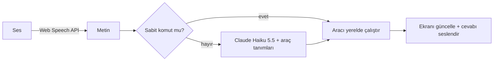

<div align="center">

# Sofrana

**Her yemek için veriyle desteklenen tek tarif ve sesle yönetilen mutfak modu.**

Sofrana aynı yemeğin onlarca versiyonunu karşılaştırır, aşçıların çoğunun üzerinde birleştiği "konsensüs tarifi" çıkarır ve her malzemenin *neden* orada olduğunu gösterir. Tarayıcıda çalışır, telefona uygulama gibi yüklenir.

*Sofrana — her yemeğin tek tarifi.*

[Yol haritası](docs/ROADMAP.md) · [English](README.md) · Canlı demo ve video: yakında

</div>

> **Durum:** geliştirme aşamasında (10 günlük planın 1. günü). İki junior full stack geliştiricinin iki haftada yaptığı, ticari olmayan portföy projesidir.

---

## Neden Sofrana?

"Karnıyarık" arayan biri yüzlerce farklı tarif bulur; hangisinin gerçekten tuttuğunu bilmez. Tarif sayfaları reklam ve uzun hikâyelerle doludur, mutfakta yağlı ellerle ekranı kaydırmak zordur.

Sofrana bunu üç fikirle çözer:

1. **Her yemek için tek bir konsensüs tarif:** aynı yemeğin 10–15 açık versiyonundan çıkarılır.
2. **Şeffaflık:** "Neden böyle?" paneli her malzemenin kaç versiyonda geçtiğini gösterir.
3. **Eller serbest pişirme:** her telefonda çalışan, sesle yönetilen bir mutfak modu.

## Özellikler

| | Özellik | Ne gösterir | Sahibi |
| --- | --- | --- | --- |
| 1 | **Konsensüs tarif ve "Neden böyle?" paneli** | Veri hattı, LLM destekli normalleştirme, animasyonlu veri görselleştirme | A |
| 2 | **Akıllı kişi sayısı ve Menü oluştur** | Birim dönüşümü, doğrusal olmayan ölçekleme, pişirme sırası planlayıcı | B |
| 3 | **Sesli mutfak modu** | Konuşma tanıma, kural tabanlı komut çözümleme, Claude araç kullanımı | B |
| 4 | **"Elimde ne var?" araması** | Postgres tam metin ve trigram arama, yazım hatasına dayanıklılık | A |
| 5 | **Yöresel mutfak haritası** | 5 ilin etkileşimli SVG haritası ve yemekleri | A |
| 6 | **Telefona yüklenebilir (PWA)** | Ana ekrana ekleme, pişirirken ekranın açık kalması, son tarifler internetsiz | B |

Her birimiz üç özelliğin veritabanından ekrana kadar sahibiyiz. Her özelliğin ölçülebilir "bitti" kriteri [yol haritasında](docs/ROADMAP.md#definition-of-done) yazılıdır.

## Konsensüs tarif nasıl çıkarılır?

```text
Bir yemeğin 10–15 versiyonu
        │  (yalnızca malzeme listeleri, kaynağıyla birlikte elle girilir)
        ▼
Normalleştir  "1 su bardağı un" → 120 g, eş anlamlıları birleştir   (Claude Haiku 5.5, toplu)
        ▼
Say           versiyonların ≥ %60'ında → çekirdek
              %25–60                    → opsiyonel varyasyon
              < %25                     → elenir
        ▼
Miktar        her malzemenin medyan miktarı, 4 kişiye ölçeklenir
        ▼
Yaz           adımlar kendi cümlelerimizle, TR + EN                 (Claude Sonnet 5.5, toplu)
        ▼
Dene          kendimiz pişiririz → "denendi" rozeti
```

## Sesli mutfak modu: önce kurallar, gerekirse Claude

Sabit komutlar hiçbir zaman LLM'e gitmez; yalnızca serbest sorular Claude'a gider. Böylece asistan hem hızlı hem neredeyse ücretsizdir.



## Neden ayrı mobil uygulama değil de PWA?

Tek kod tabanı. Mutfak modunun ihtiyacı olan her şey (ses tanıma, ekranın açık kalması, çevrimdışı çalışma) bugün tarayıcıda var. İş mantığı `src/lib/core` klasöründe saf fonksiyonlar olarak durduğu için ileride yerel bir mobil uygulamaya taşınabilir.

## Teknoloji

Next.js 16, TypeScript, pnpm · Tailwind, shadcn/ui, Motion · Serwist ve Screen Wake Lock API ile PWA · Supabase üzerinde PostgreSQL, Drizzle ORM, pg_trgm · Supabase Auth · Claude API (Haiku 5.5, Sonnet 5.5) · Web Speech API · next-intl · Vitest, Playwright · GitHub Actions, Vercel

Mimari çizim, klasör yapısı ve kalite hedefleri için [İngilizce README'ye](README.md#architecture) bakın.

## Kurulum

```bash
git clone https://github.com/sofrana/sofrana.git
cd sofrana
pnpm install
cp .env.example .env.local   # anahtarları doldurun
pnpm db:migrate
pnpm db:seed                 # örnek yemekleri yükler
pnpm dev                     # http://localhost:3000
```

## Ekip

| | Sorumlu olduğu kısımlar |
| --- | --- |
| **A** · İsim A | Konsensüs hattı ve "Neden böyle?" paneli, "Elimde ne var?" araması, yöresel harita · veritabanı şeması, veri betikleri, yönetim formu, giriş |
| **B** · [@kutluktaskin](https://github.com/kutluktaskin) | Kişi sayısı ve Menü oluştur, sesli mutfak modu, PWA · proje kurulumu, CI, Vercel, tasarım sistemi |

Her PR'ı diğerimiz inceleyip onaylamadan birleştirilmez. Ayrıntılar için [CONTRIBUTING.md](CONTRIBUTING.md).

## AI kullanımımız

Claude'u eşli programlama aracı olarak kullanıyoruz. Kurallarımız: AI desteğiyle yazılan kodu yazan kişi PR'da kendi cümleleriyle açıklar, çekirdek iş mantığının testlerini kendimiz yazarız ve açıklayamadığımız hiçbir kod birleştirilmez.

## Veri ve telif

Tarif verisi elle derlenir. Yalnızca **malzeme listeleri ve miktarlar** kaynak linkiyle saklanır; ABD Telif Ofisi'ne göre salt malzeme listesi telifle korunmaz ([Circular 33](https://www.copyright.gov/circs/circ33.pdf)). Tarif metni veya fotoğraf kopyalanmaz, web sitelerinden otomatik veri çekilmez. Tüm adımlar kendi cümlelerimizle yazılır, tüm fotoğraflar bize aittir.

## Lisans

Kod için [MIT](LICENSE). Bu repodaki tarif metinleri ve fotoğraflar © Sofrana ekibi.
